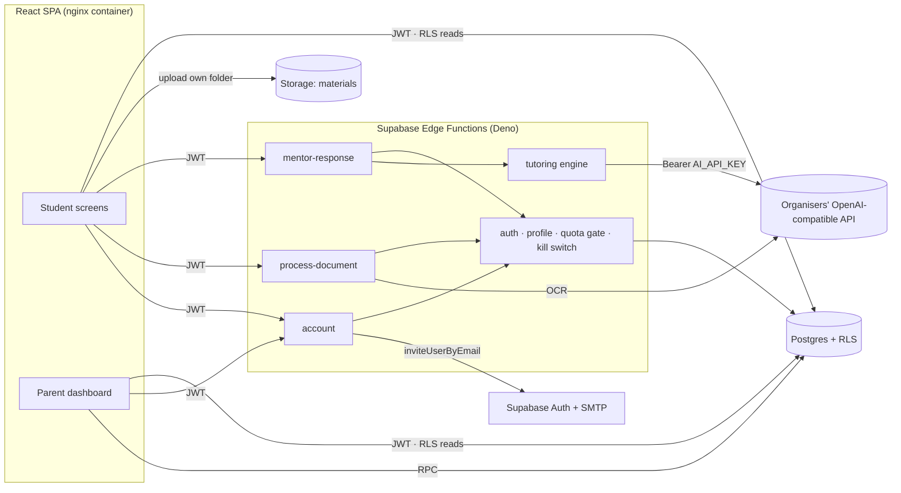
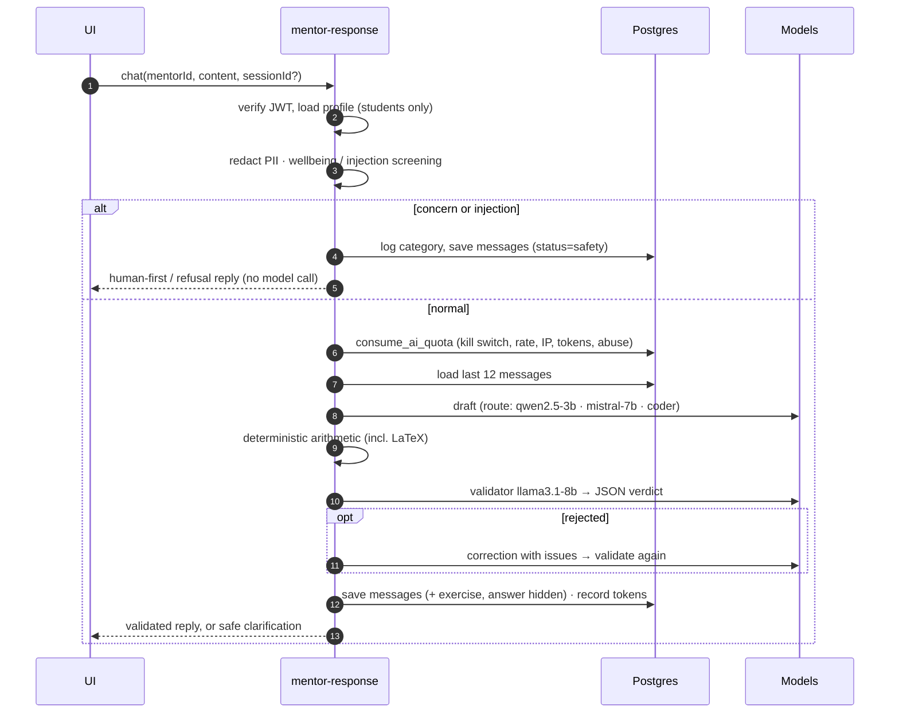
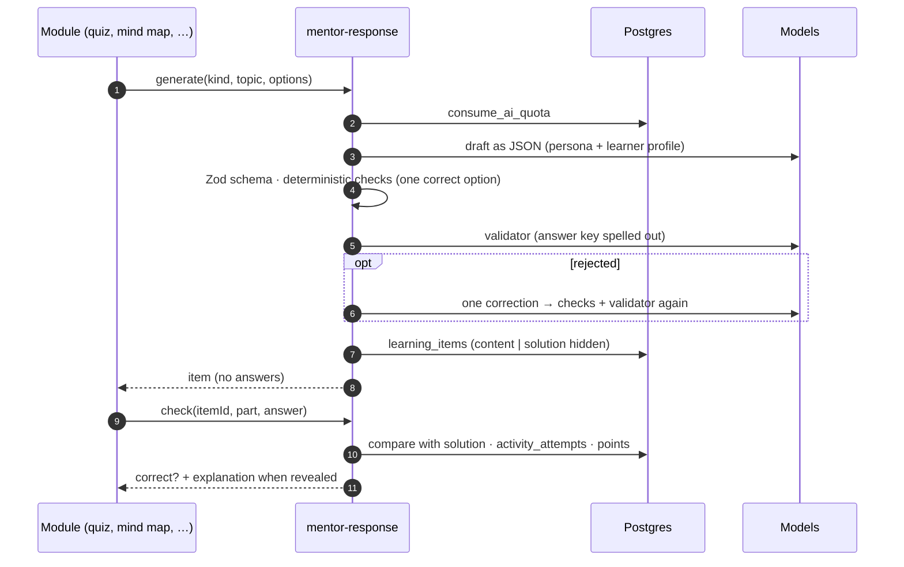

# Architecture



## Tutoring turn



## Learning activities



Nine experiences share this engine: Chat & Explain and Ask-Why use `chat`; Smart Summary, Key Terms, Mind Map, Quiz, Flashcards, STEM Game, Teach Me Back and the onboarding warm-up use `generate`/`check`. Each module is a thin view in `src/features/learning/modules/` on top of shared pieces: `ModuleShell` (mentor character, states, back link), `ActivityFrame` (topic → options → generate → result → history) and `useActivity` (item in the URL, so every activity can be reopened).

## Interface language and accessibility

- `src/i18n/strings.ts`: typed dictionaries for English, French, Arabic and Tunisian Darija (Darija inherits Arabic and overrides what differs). Every key must exist in every language (enforced by the type). Mentor descriptions are localised in `src/data/mentorText.ts`. Arabic and Darija switch the document to `dir="rtl"`; layouts use logical properties.
- `src/store/prefsStore.ts` + `src/app/PrefsEffects.tsx`: preferences apply instantly through attributes on `<html>` (`data-text-size`, `data-contrast`, `data-spacing`, `data-motion`, `data-focus`) and `MotionConfig`. They are saved to the profile; local edits not yet saved win over the profile copy on reload (`pendingSync`).

## Code layout

```
supabase/functions/
  _shared/          api contract, http/CORS, auth context + quota gate, safety, grading
  mentor-response/  index (router) · chat · grade · learn (generate/check) · activities (schemas, prompts, checks, split) · orchestrator · validator · mathCheck · modelRouter · prompts/ · providers/
  process-document/ index · handler · extract (magic bytes, unpdf, OCR)
  account/          export · delete · invite_guardians
supabase/migrations/  schema · triggers & quota · RLS & privileges · storage & seed · accounts & guardians · learning experiences
src/
  services/         supabase client · api (functions) · data (RLS queries & RPCs) · documents (upload)
  store/            auth (session, profile, roles) · prefs (language, accessibility)
  i18n/             strings (en · fr · ar · tn) · languages
  features/learning/ experiences · ModuleShell · ActivityFrame · TopicField · hooks (character state, speech, sounds) · modules/
  pages/            Landing · Login · Register · Onboarding · Dashboard · Mentors · Learning (space + module) · Progress · Settings · Account · Parent · ParentWelcome
  components/       ui · layout (RequireAuth with roles and onboarding redirect) · chat · exercises · mentors (character art with four states) · account · dashboard · progress
deploy/nginx.conf.template · Dockerfile · docker-compose.yml
tests/integration (real Supabase) · tests/e2e (browser, real Supabase + Mailpit)
```

The engine modules are runtime-agnostic: Deno in production, Node in tests. Bare `zod`, `@supabase/supabase-js` and `unpdf` are mapped per function in `deno.json`.
