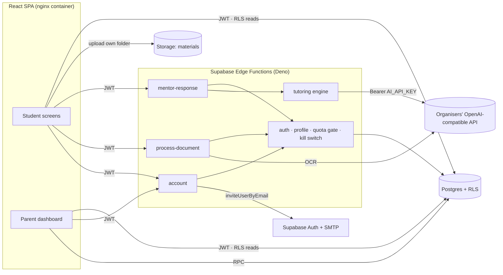
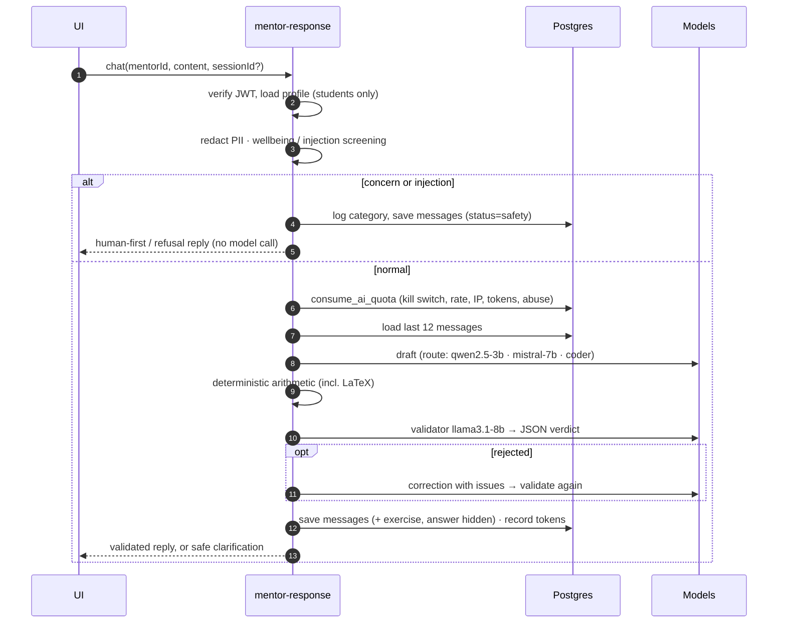

# Architecture



## Tutoring turn



## Code layout

```
supabase/functions/
  _shared/          api contract, http/CORS, auth context + quota gate, safety, grading
  mentor-response/  index (router) · chat · grade · orchestrator · validator · mathCheck · modelRouter · prompts/ · providers/
  process-document/ index · handler · extract (magic bytes, unpdf, OCR)
  account/          export · delete · invite_guardians
supabase/migrations/  schema · triggers & quota · RLS & privileges · storage & seed · accounts & guardians
src/
  services/         supabase client · api (functions) · data (RLS queries & RPCs) · documents (upload)
  store/            auth (session, profile, roles) · prefs (language)
  pages/            Landing · Login · Register · Dashboard · Mentors · Learning · Progress · Account · Parent · ParentWelcome
  components/       ui · layout (RequireAuth with roles) · chat · exercises · mentors · account · dashboard · progress
deploy/nginx.conf.template · Dockerfile · docker-compose.yml
tests/integration (real Supabase) · tests/e2e (browser, real Supabase + Mailpit)
```

The engine modules are runtime-agnostic: Deno in production, Node in tests. Bare `zod`, `@supabase/supabase-js` and `unpdf` are mapped per function in `deno.json`.
