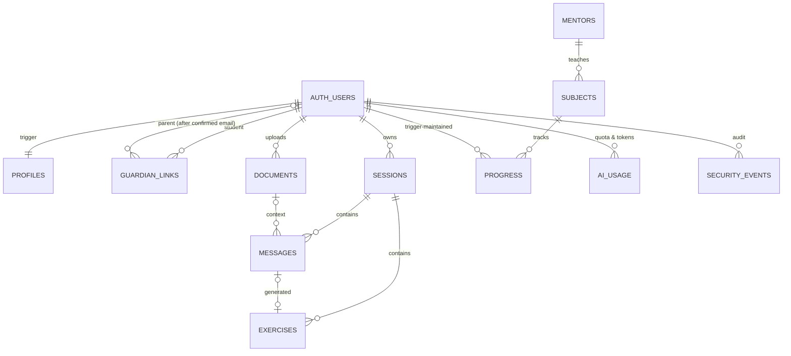

# Database

PostgreSQL 17 (Supabase). Migrations are in `supabase/migrations/`. They are verified in two ways: on PGlite (`supabase/migrations.test.ts`, 17 tests), and applied to the real local Supabase stack by `supabase db reset` and exercised by `tests/integration` (20 tests).

| Table                 | Purpose                                                                              | Client access                                                                        |
| --------------------- | ------------------------------------------------------------------------------------ | ------------------------------------------------------------------------------------ |
| `profiles`            | `account_type` (student/parent), nickname, age band, guardian consent time, language | read own; update nickname/language only                                              |
| `guardian_links`      | student ↔ guardian email ↔ parent; `pending` / `active` / `revoked`                  | read (student or linked parent); changes via RPCs                                    |
| `mentors`, `subjects` | Reference data                                                                       | read (everyone)                                                                      |
| `sessions`            | Learning sessions                                                                    | read, rename, delete own                                                             |
| `messages`            | Conversation history; status, validation metadata, redaction flag, safety flags      | read own                                                                             |
| `exercises`           | Questions, hidden answers, attempts, grading                                         | **none** (read through the `my_exercises` view, which masks answers until completed) |
| `documents`           | Uploaded material, extracted text, injection flags                                   | read, delete own                                                                     |
| `progress`            | Per subject: sessions, questions, exercises completed/correct                        | read own (trigger-maintained)                                                        |
| `ai_usage`            | One row per AI request, with prompt/completion tokens                                | none (service only)                                                                  |
| `security_events`     | Audit: sign-ups, injections, wellbeing categories, quota blocks, links, exports      | none                                                                                 |
| `system_flags`        | `ai_enabled` kill switch                                                             | none                                                                                 |

**Triggers:**

- `handle_new_user`: validates sign-up metadata per account type; aborts on missing consent or guardian email for minors
- `session_default_subject`, `exercise_default_subject`
- `progress_on_session`, `on_message_insert`, `progress_on_exercise`

**Functions:** see [API.md](API.md#database-rpcs-called-with-the-users-jwt) and [SECURITY.md](SECURITY.md). Security-definer functions pin `search_path = ''`; server-only functions have `EXECUTE` revoked from client roles.

**Storage:** private `materials` bucket (10 MB, text/PDF/images); policies restrict objects to `<auth.uid()>/…`.
